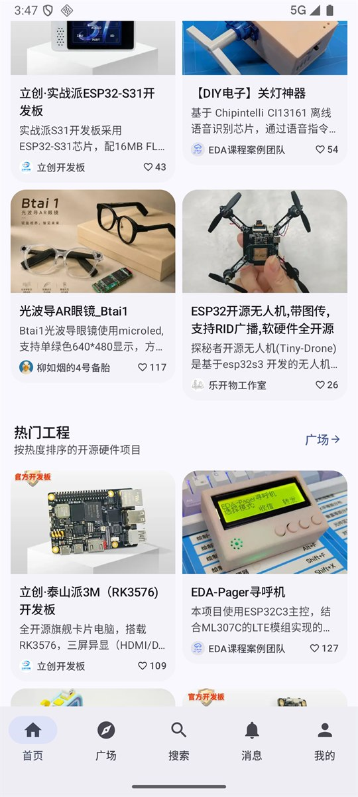
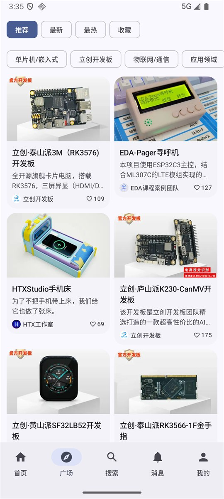
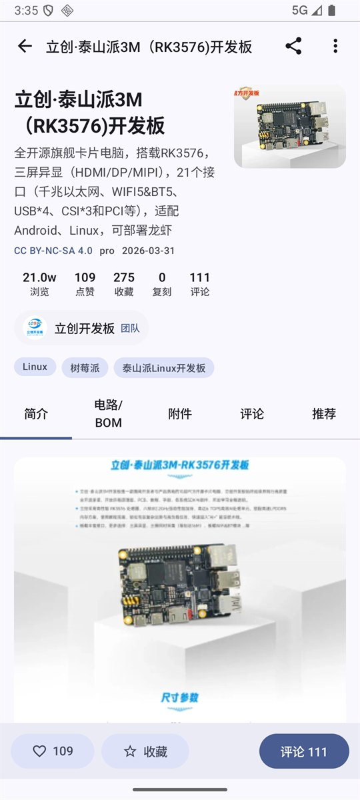
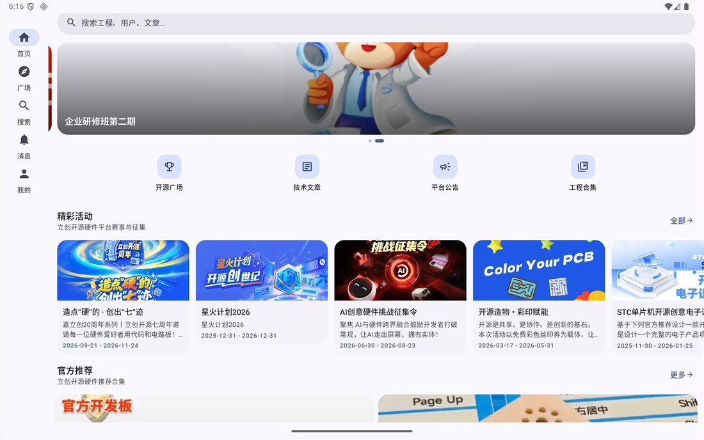
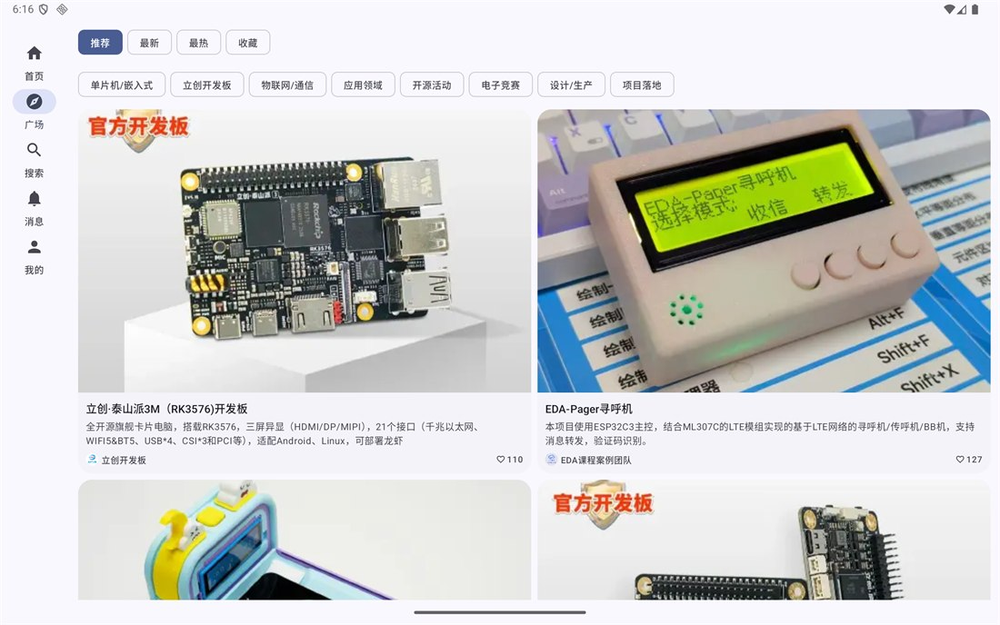
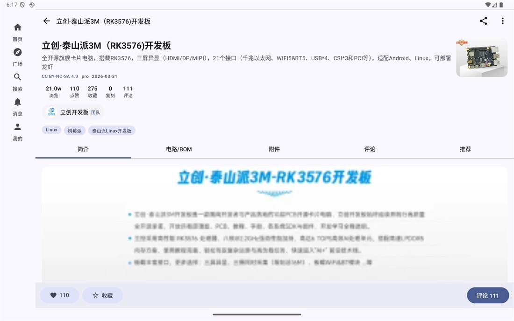

# oshwhub Android 客户端

立创开源硬件平台（oshwhub.com）的 Android 客户端，用 Kotlin + Jetpack Compose 写的原生界面，
不是 WebView 套壳。手机竖屏和平板横屏都能用，平板会自动换成侧边导航。

## 截图

手机端：

| 首页 | 开源广场 | 工程详情 |
| --- | --- | --- |
|  |  |  |

平板端：

| 首页 | 开源广场 | 工程详情 |
| --- | --- | --- |
|  |  |  |

## 能做什么

- **首页**：轮播 banner、快捷入口、精彩活动、官方推荐、热门工程
- **广场**：按分类和排序（推荐 / 最新 / 最热 / 收藏）浏览工程，滚动分页
- **搜索**：工程、用户、文章、帖子四类结果，带热词和结果计数
- **工程详情**：简介、电路/BOM、附件、评论、推荐五个标签页，点赞收藏关注、评论区回复
- **文章**：技术文章与资讯列表、分类筛选、Markdown 正文、评论
- **帖子**：论坛列表和详情
- **合集**：官方合集列表、合集内工程
- **用户**：个人主页、工程/文章/帖子/收藏/关注/粉丝
- **消息**：全部 / 未读 / 私信切换，分页加载；点开单条即标已读并跳转，角标同步减少，
  「全部已读」后角标清零
- **活动**：赛事征集列表和详情
- **站内跳转**：正文、评论、消息里的 `oshwhub.com` 链接全部在 App 内解析成原生页面
  （工程 / 文章 / 用户 / 合集 / 活动 / 搜索），解析不出来才落内置 WebView，不弹系统浏览器
- **检查更新**：设置里直接读 GitHub Releases 比对版本号，比 `BuildConfig.VERSION_NAME`
  新就给下载入口
- **其它**：深色模式、纯黑主题、动态取色、图片自适应、空态与错误重试

## 登录

站点用的是立创统一登录（passport.jlc.com）的 CAS 流程，App 里有两种登录方式：

- **账号密码 / 手机验证码**：密码走 SM2 加密后直接调 CAS 接口，再拿 `AC-` 票据换 oshwhub 会话。
- **用浏览器登录**：在内置 WebView 里打开真实登录页，滑块和验证码都在页面里正常完成。
  URL 里一出现 `AC-` 票据就拦下这次跳转，改由 OkHttp 调 `login-by-code` 自己换会话，
  这样会话 cookie 直接落在 App 自己的 CookieStore 里，重启不掉登录。

登录接口有 WAF 保护，纯 HTTP 客户端在部分网络下会被判定环境异常，这种情况走浏览器登录即可。

## 构建

用 Android Studio 自带的 JDK 就行：

```powershell
$env:JAVA_HOME="C:\Users\lenovo\AppData\Local\Programs\Android Studio 2\jbr"

.\gradlew.bat :app:assembleDebug       # 产物在 app/build/outputs/apk/debug/app-debug.apk
.\gradlew.bat :app:testDebugUnitTest   # 接口契约测试，会真的请求线上接口
```

最低 Android 12（minSdk 31），compileSdk 37，Gradle 9.3.1。

还有一个契约测试会依次请求首页、搜索、详情、用户等关键接口，打印每个端点的成功率和失败原因。
站点改版或者网络不通时会红，属于预期行为。

## 代码结构

```
app/src/main/java/io/github/Calvariaa/oshwhub/
├── data/
│   ├── net/ApiClient.kt        OkHttp + 持久化 Cookie + 统一 UA/Referer + 信封解析
│   ├── net/CookieStore.kt      Cookie 落盘，重启保留登录态
│   ├── net/WebCookieBridge.kt  WebView 的 cookie 同步给 OkHttp
│   ├── OshApi.kt               所有站点接口集中在这里
│   ├── AuthRepository.kt       CAS 登录（SM2 / 短信 / 票据兑换）
│   ├── crypto/Sm2.kt           纯 Kotlin SM2 加密
│   ├── model/Models.kt         DTO 和几个容错序列化器
│   └── AppContainer.kt         依赖容器 + SessionManager
└── ui/
    ├── AppRoot.kt              路由、NavHost、底部栏 / 侧边导航切换
    ├── <feature>/XxxScreen.kt  每个页面一个 ViewModel + Screen
    ├── components/             卡片、空态、Markdown 渲染、评论区
    └── theme/                  Material 3 主题
```

数据流很直白：`Screen → ViewModel → OshApi → ApiClient → OkHttp`，登录态用
`SessionManager.user` 这个 StateFlow 广播，各页面自己 collect。

## 已知问题

- 手机号登录和短信接口在部分网络环境下要先过 WAF 验证，走「用浏览器登录」能绕过。
- 发布工程、在线编辑器、PCB 预览这类强交互功能没做，网页端依赖 EDA 画布，没法简单搬过来。
- 接口是照着站点 web 端调的，站点改版后可能需要跟着改。

## 说明

个人学习用的第三方客户端，和立创开源硬件平台没有隶属关系，所有内容和数据版权归原平台及原作者。
